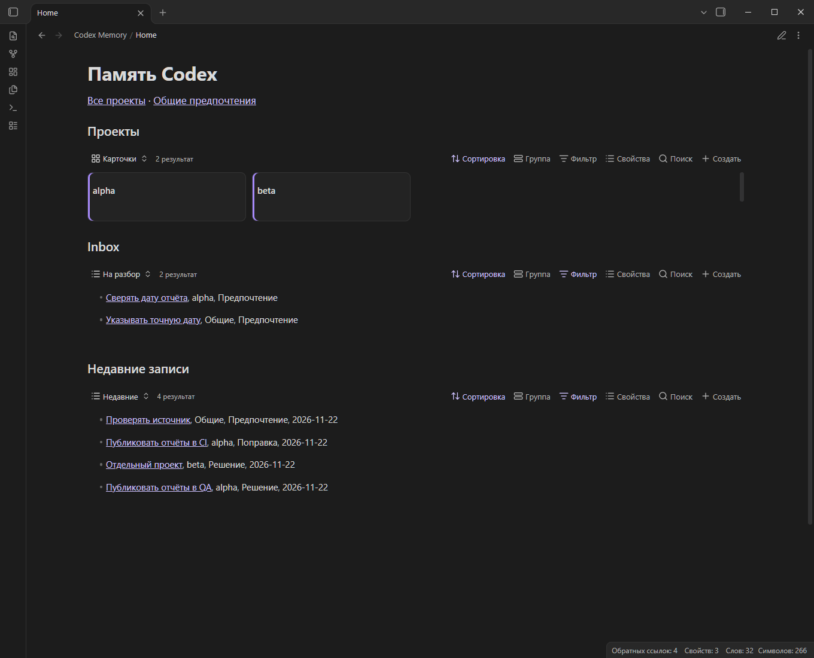
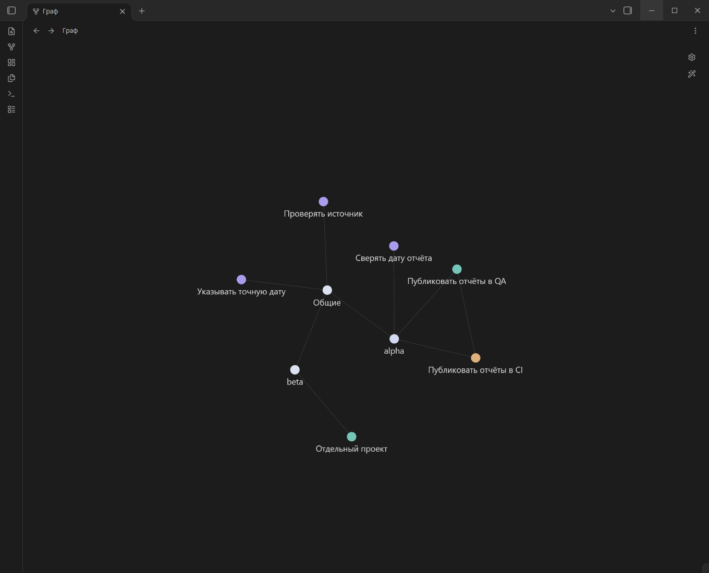
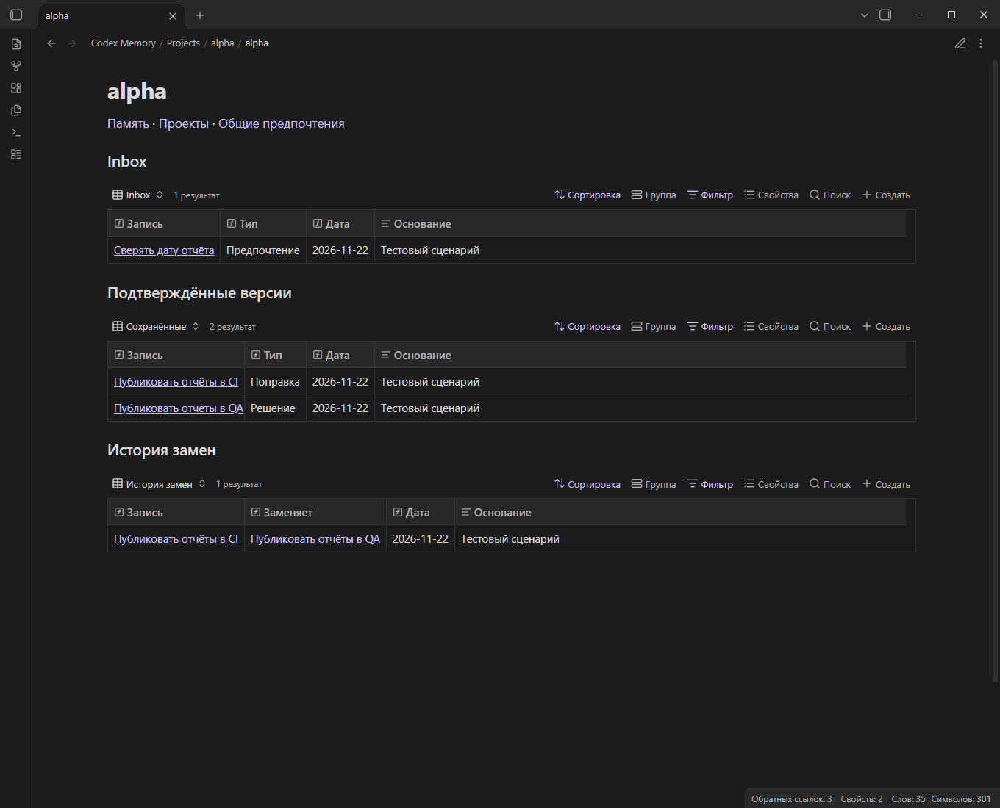

# fmem

**Агент помнит решения. Ты видишь и редактируешь их в Obsidian.**

Локальная память на Rust: автоматические хуки Codex, Markdown-хранилище,
гибридный поиск и MCP для других агентов. Один нативный бинарник, без Python
в рабочем процессе.

[Быстрый старт](#быстрый-старт) · [Автопамять](#автопамять) ·
[Obsidian](#obsidian) · [RAG](#поиск-по-смыслу) · [MCP](#другие-агенты) ·
[Руководство](docs/usage.md)

| Для агента | Для тебя |
| --- | --- |
| Применимые правила появляются в контексте задачи | Заметки читаются как обычный Markdown |
| Долговечные выводы сохраняются в конце хода | Проекты, Inbox и предпочтения собраны на главной |
| Повтор операции не создаёт дубликат | У записи есть источник и история замен |
| Контекст короткий, полный текст доступен по ID | Индекс можно построить заново из файлов |

## Быстрый старт

Скачай архив своей платформы из [сборок](https://github.com/WhyFaust/fmem/actions/workflows/check.yml)
или [выпусков](https://github.com/WhyFaust/fmem/releases) и распакуй целиком.
Внутри находятся бинарник, плагин Codex, документация и лицензии.
Поддерживаются Windows x64, Linux x64, macOS Intel и Apple Silicon.

### Windows

```powershell
& 'C:\Tools\fmem\fmem.exe' --project-dir 'C:\Projects\example' init --vault 'D:\Notes' --project example
& 'C:\Tools\fmem\fmem.exe' codex install --package 'C:\Tools\fmem'
```

### Linux и macOS

```bash
/opt/fmem/fmem --project-dir /work/example init --vault /notes/vault --project example
/opt/fmem/fmem codex install --package /opt/fmem
```

Пути выше — примеры; vault уже должен существовать. Установка использует штатные
команды Codex. Один раз подтверди доверие хукам в клиенте. После подключения
обычные запросы запускают память автоматически: отдельная просьба «запомни»
для подтверждённых решений не нужна.

Проверить привязку можно командой `fmem --project-dir PATH status`.
Режим `init --mode inbox` оставляет новые выводы в Inbox для проверки;
обычный режим `auto` сохраняет подтверждённые знания сразу.

## Автопамять

**В начале задачи** хук добавляет небольшой набор записей проекта и общих
предпочтений. У фрагментов есть ID и область. Агент проверяет связь с задачей
и читает полный текст перед применением правила.

**Поиск по смыслу работает автоматически после `fmem model install`.**
Асинхронный хук запускает один фоновый процесс для активных проектов. Он держит
локальную модель в памяти и пересчитывает векторы новых и изменённых заметок.
Синхронный хук ждёт ответ этого процесса не более 150 мс; при запуске модели,
перегрузке или сбое использует лексический поиск. Из хуков ничего не скачивается.

**Перед завершением** агент тихо передаёт один пакет решений, предпочтений
и поправок с источниками. Если нового знания нет, он отмечает пропуск.
`Stop` применяет подготовленный пакет. Если агент забыл этот шаг, допускается
одно внутреннее напоминание; повторный Stop не создаёт бесконечный цикл.

**При сбое** принятую операцию хранит отдельный долговечный журнал.
Стабильный ID защищает от повторной записи. Прерывание и Plan отменяют
неприменённое разрешение хода. При следующем обычном завершении задачи fmem
повторяет одну ранее принятую операцию, в том числе из другой беседы.
Недоступная память не останавливает основную задачу и не добавляет служебных
сообщений в ответ пользователю.

Автоматика работает независимо от режима координации и поддерживает поручения
и подагентов Codex. Диагностика доступна по запросу: `fmem codex diagnostics`.
Технические вызовы остаются в журнале инструментов клиента.

## Obsidian

Открой **Codex Memory / Home**: это главная страница памяти.



*Настоящий Obsidian 1.15.1 на Windows. Демонстрационный vault с вымышленными записями.*

| Экран | Что на нём |
| --- | --- |
| Главная | Проекты, недавние записи и ожидающий проверки Inbox |
| Проект | Решения, поправки, предпочтения и сохранённые версии |
| Общие предпочтения | Правила, применимые к разным проектам одного vault |
| Закладка «Память» | Граф знаний: названия записей, проекты и связи замен |

Используются штатные Markdown и Bases. Community plugins не нужны.
При инициализации подключается небольшой CSS snippet только для страниц fmem.
Существующие страницы, пользовательский стиль и другие настройки сохраняются.
Текст, `tags`, `aliases` и `cssclasses` можно редактировать в Obsidian;
служебные идентификаторы и статусы ведёт fmem.

В **Закладках → Память** открывается штатный граф с фильтром по записям и
проектам. Названия узлов читаемые; решения, поправки и предпочтения различаются
цветом. Служебные страницы и файлы представлений в этот вид не попадают.
Связь с проектом показывает область действия, связь между версиями — замену.



Файл заметки назван по заголовку. Стабильный ID хранится в свойствах и имени
родительского каталога, поэтому одинаковые заголовки не конфликтуют, а
переименование файла внутри его каталога сохраняет доступ по ID.

<details>
<summary><strong>Страница проекта и история решений</strong></summary>



</details>

Список сохранённых версий удобен для просмотра истории. Актуальность с учётом
замен и отметок удаления проверяет runtime при поиске.

## Поиск по смыслу

Лексический поиск работает сразу. Для автоматического семантического поиска
Codex один раз установи локальную модель:

```bash
fmem model install
```

Следующие обычные задачи запускают индексацию и поиск через хуки.
Отдельные CLI и MCP также поддерживают `search`, `context` и `index --semantic`.

`multilingual-e5-small` работает на CPU и поддерживает русские и английские
запросы. SQLite FTS5 находит точные термины и русские словоформы; `sqlite-vec`
ищет близкие векторы; режим `hybrid` объединяет обе выдачи через RRF.
Отдельный сервер векторной БД не требуется.

Модель скачивается только явной командой установки; последующая работа локальная.
Для клиентов без хуков доступен `index --semantic --watch`. В MCP модель остаётся
загруженной между запросами. Ранжирование даёт кандидатов: даже нерелевантный
запрос может иметь ближайшие векторы, поэтому агент проверяет содержание.

> Индексируется управляемая память **Codex Memory**. Произвольные страницы
> всего vault, PDF и вложения не входят в этот поиск. Модель обрабатывает до
> 512 токенов записи; одно короткое правило на заметку даёт более точный результат.

## Другие агенты

fmem предоставляет stdio MCP. Привяжи сервер к рабочему проекту клиента:

```json
{
  "mcpServers": {
    "memory": {
      "command": "/opt/fmem/fmem",
      "args": ["--project-dir", "/work/example", "mcp"]
    }
  }
}
```

| Инструмент | Результат |
| --- | --- |
| `memory_context` | Ограниченный по размеру контекст с источниками |
| `memory_read` | Полная запись и история по ID |
| `memory_status` | Привязка, состояние и квитанция операции |
| `memory_commit` | Пакет устойчивых операций |
| `memory_retry` | Повтор временно неудавшихся записей |

`--read-only` перед `mcp` оставляет только инструменты чтения.
MCP работает с проектом, выбранным при запуске. Автоматический вызов инструментов
в другом клиенте определяется настройками этого клиента.

## Скорость и проверка

В проверке через настоящий Codex прогретый синхронный хук занял **68 мс по
медиане и 102 мс по p95** на маленьком корпусе из четырёх заметок. В замер входят
оболочка, процесс, локальное взаимодействие и поиск; генерация ответа модели
не входит. Автоматически проверены индексация, правка в Obsidian и забывание.

Нативный синхронный хук на 1000 синтетических заметках занял **35 мс по
медиане и 39 мс по p95**. Этот замер включает обновление индекса и recall,
но не включает Codex и модель. Читаемые имена с отдельным каталогом ID
добавили около 17 мс относительно плоского расположения файлов.
[Методика, окружение и семантические проверки →](docs/verification.md)

Проверки покрывают области проектов, повторные операции, восстановление,
редактирование и забывание записей, фильтрацию до top-k, MCP и жизненный цикл
хуков. Сборки проверяются на четырёх платформах.

<details>
<summary><strong>Собрать из исходников</strong></summary>

Нужны Rust 1.90.0, Git и системный C/C++ toolchain.

```bash
git clone https://github.com/WhyFaust/fmem.git
cd fmem
cargo build --release --locked
cargo test --release --locked
```

Бинарник: `target/release/fmem`, на Windows — `target/release/fmem.exe`.
Проверки перед отправкой: `cargo fmt --check`,
`cargo clippy --all-targets --locked -- -D warnings`,
обычные release tests и `--no-default-features`.

</details>

---

[Подробное руководство](docs/usage.md) · [Проверка поиска](docs/verification.md) ·
[MIT License](LICENSE)
